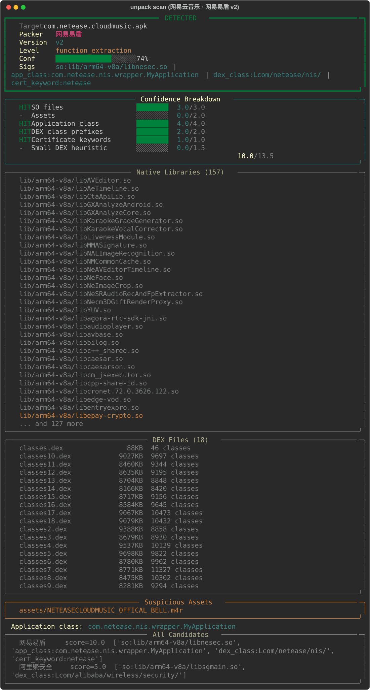
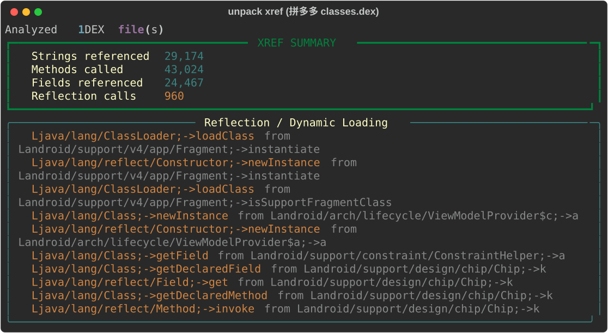
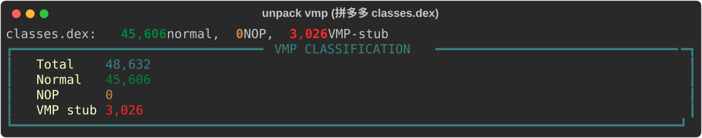
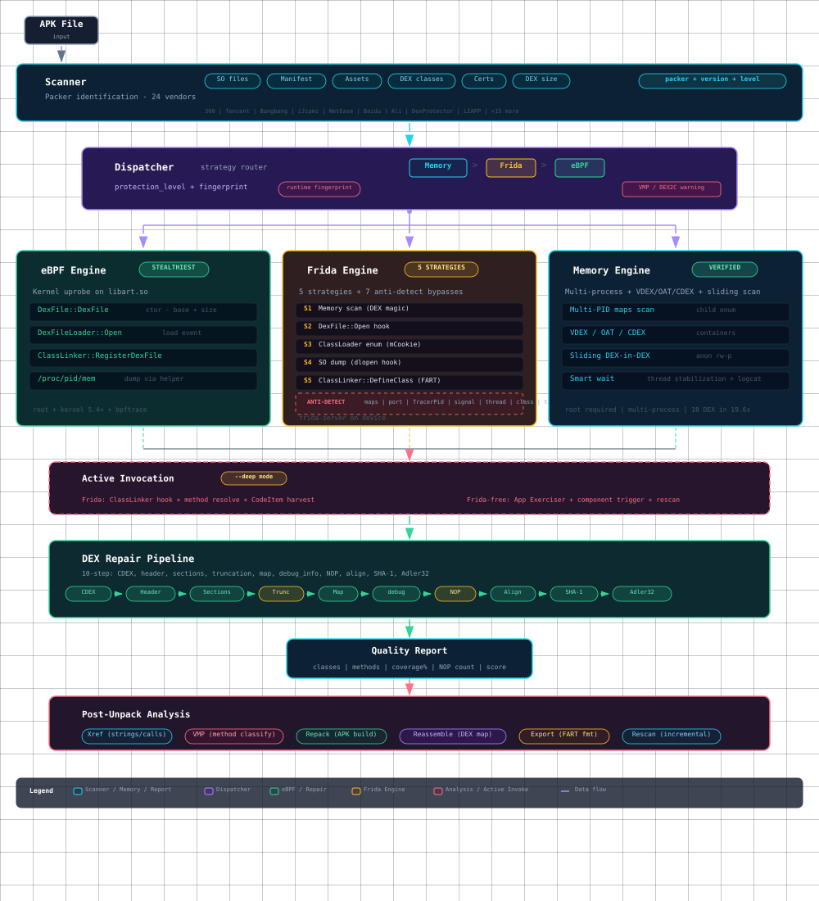

<div align="center">

# UNPACK

**商业级 Android 脱壳、10 步 DEX 修复、静态/VMP 逆向分析、AI 研判与合规审计平台**
<br>
*End-to-End Android Unpacking · 10-Step DEX Repair · UNPACK Studio · 7-Provider AI · SQLite Workspaces · SARIF 2.1.0*

[](https://github.com/overkazaf/unpack)
[](#24-家壳厂商识别)
[](#cli-完整命令参考)
[](#项目结构)
[](#安装)
[](#license)

**[产品主页](https://overkazaf.github.io/unpack/)** ·
**[交互式架构图](docs/architecture.html)** ·
**[UNPACK Studio](docs/studio.html)** ·
**[CLI 参考](docs/cli.html)** ·
**[Memory 引擎](docs/engine-memory.html)** ·
**[Frida 引擎](docs/engine-frida.html)** ·
**[eBPF 引擎](docs/engine-ebpf.html)**

</div>

---

## 核心价值：一站式解决 Android 脱壳与逆向工程痛点

传统 Android 脱壳工具往往“各自为战、dump 完即丢、缺乏质量量化、无可视化与归档能力”。UNPACK 将 **壳识别 → 智能路由 → 三引擎脱壳 → 主动调用 → 10 步修复 → VMP/XRef/ELF 检视 → AI 研判 → SQLite 工作区 → 合规审计报告** 整合为一套商业级 CLI + Web 工作台：

| 痛点 | UNPACK 商业级解决方案 |
|------|----------------------|
| **工具碎片化** | **三引擎自动调度**（`core/dispatcher.py`）：根据壳特征与运行时 `/proc` 行为指纹自动在 Memory / Frida / eBPF 间路由，并支持失败自动降级。 |
| **dump 完就丢，jadx 崩溃** | **10 步 DEX 修复流水线 + Diff 对比**（`repair/dex_repair.py`）：自动完成 CDEX 转换、头部修正、Section 越界清零、截断恢复、对齐、debug_info 清理、NOP 标注与 SHA-1/Adler32 重算。 |
| **不知脱壳完整度** | **质量验证 + 多格式审计报告**（`core/reporting/`）：统计类/方法覆盖率与残留 NOP 方法，一键输出去重后的 **HTML5 / Markdown / JSON / SARIF 2.1.0** 审计报告。 |
| **壳识别依赖人工经验** | **24 家壳厂商 × 6 维加权评分**（`core/scanner.py` + `signatures.py`）：无需真机即可识别 24 家国内外加固厂商、版本（如 360 v1–v4、乐固 v1–v3）及保护等级（DEX / 函数抽取 / VMP / DEX2C）。 |
| **反检测各自硬编码** | **统一 7 项反检测绕过模块**：在 Frida `script.load()` 后、`device.resume()` 前同步生效，Frida 引擎与主动调用共用同一套实现，可通过 `--no-anti-detect` 一键开关。 |
| **缺乏团队工作台与 AI 协同** | **UNPACK Studio（7 视图 Web 工作台）+ 内置 7 大模型 AI 引擎 + SQLite 持久化工作区**：支持三栏 DEX 反汇编、修复差异对比、6 阶段引导式流水线、样本快照自动重定位与双语（`zh`/`en`）界面。 |

### 全链路数据驱动流水线

```text
APK / DEX 输入
  → scan / inspect（24 家壳识别 + Manifest / 签名 / 原生 ELF / DEX 静态检视）
    → doctor / pipeline（实时环境预检 + 零设备离线或真机 6 阶段规划）
      → dispatcher（按保护等级 + 运行时行为指纹自动路由：Memory > Frida > eBPF）
        → engine dump（DEX / SO 提取，含多进程与 APEX 感知）
          → --deep 主动调用（Frida ClassLinker Hook 或 免 Frida App Exerciser + CodeItem 合并）
            → 10 步 DEX 修复 + 流式 SHA-256 去重 + 完整性校验
              → VMP 标注 / XRef 索引 / APK 重打包 / DEX 重组 / FART 导出
                → 内置 7 模型 AI 研判 + SQLite 工作区归档 + HTML5 / MD / JSON / SARIF 2.1.0 报告
```

---

## 安装

```bash
python3 -m venv .venv
source .venv/bin/activate

# 基础核心（CLI + Scanner + 10 步修复 + 报告 + SQLite 工作区 + 内置 AI 客户端）
pip install -e .

# 按需安装扩展能力
pip install -e ".[web]"        # UNPACK Studio (Flask Web 工作台)
pip install -e ".[frida]"      # Frida 脱壳引擎与主动调用
pip install -e ".[analysis]"   # androguard + lief + cryptography（深度 APK/ELF/证书检视）
pip install -e ".[all]"        # 全部功能（推荐）
```

> 首次使用建议运行 `unpack doctor` 检查环境依赖、ADB 设备与引擎就绪度，或运行 `unpack guide`（别名 `unpack wizard`）进入交互式向导。

---

## 快速开始

### 1. 环境体检、静态识别与深度检视（无需真机）



```bash
# 环境与引擎体检
unpack doctor

# 识别壳厂商、版本与保护等级（支持中英文切换 --lang zh|en）
unpack scan app.apk -v
unpack scan ./apks/ --batch --json batch_scan.json

# 深度静态检视 APK（Manifest、签名、权限、原生 ELF）或 DEX（类、方法、Dalvik 反汇编）
unpack inspect app.apk --permissions
unpack inspect classes.dex --classes --disasm MainActivity.onCreate

# 零设备离线全链路分析（scan → inspect → vmp → xref → report）
unpack pipeline app.apk --mode offline --execute
```

### 2. 真机自动脱壳、10 步修复与验证

```bash
# 自动调度最优引擎完成 scan → dump → repair → verify
unpack dump app.apk
unpack dump app.apk -o ./output -e memory
unpack dump app.apk -e frida --deep --report-html report.html   # 主动调用对抗函数抽取壳 + HTML 报告
unpack dump app.apk -e ebpf -d DEVICE_SERIAL

# 独立修复与质量验证
unpack repair ./unpacked/ --in-place
unpack verify ./unpacked/ --json verify.json
```

### 3. 脱壳后分析与重构






```bash
# APK 重打包（原始资源 + 修复后 DEX → 直接拖入 jadx / JEB）
unpack repack app.apk ./unpacked/ -o ./repacked

# 交叉引用索引（字符串、方法调用、反射、字段）
unpack xref ./unpacked/ --search "decrypt" -j xref.json

# VMP 方法级分类（normal / NOP / VMP-stub）
unpack vmp ./unpacked/ -j vmp.json

# DEX 重组（还原原始 multi-DEX 编号分布）
unpack reassemble app.apk ./unpacked/

# FART 格式导出（fart.bin + fart.txt）
unpack export ./unpacked/ -f fart

# 免 Frida 增量重扫（触发组件唤醒更多按需解密方法）
unpack rescan app.apk ./unpacked/ -r 5

# 生成商业级审计报告（HTML5 / Markdown / JSON / SARIF 2.1.0）
unpack report ./unpacked/ --apk app.apk --format sarif --vmp --xref --out audit.sarif
```

---

## UNPACK Studio（商业级 7 视图 Web 工作台）

> 完整介绍见 [docs/studio.html](docs/studio.html)

```bash
pip install -e ".[web,analysis]"
unpack web                    # 默认启动 http://127.0.0.1:8080
unpack web --port 3000        # 自定义端口（亦可使用独立入口 unpack-web）
```

UNPACK Studio 采用零外部 CDN 依赖前端与模块化 Flask Blueprint 后端（`src/unpack/studio/`），提供完整的交互式逆向体验：

- **7 大核心视图**：
  1. **Samples & Intake**：拖拽上传 APK/DEX、本地样本库导入、SHA-256 去重缓存、**目录迁移后 SHA-256 自动重定位**、源文件离线时的**快照只读模式（Snapshot-Only）**显式提示。
  2. **Scan & Intelligence**：24 家壳识别 6 维证据面板、置信度条、保护等级徽章与一键 AI 策略简报。
  3. **APK & DEX Inspector**：Manifest / 签名证书 / 权限风险 + **三栏式 DEX 浏览器（类树 · 方法表 · Dalvik 反汇编 · 字符串/IOC 检索）**。
  4. **VMP & Native Studio**：方法级 VMP/NOP 分类筛选 + 原生 ELF `.so` 反调试/VMP/DEX2C/加密指标检视。
  5. **Repair & Verify Lab**：10 步 DEX 修复前后 **Header/指标 Diff 对比**、覆盖率评估、FART 导出与 APK 重打包。
  6. **Pipeline Studio**：**6 阶段引导式流水线规划器**，联动 Environment Doctor 预检，支持零设备离线执行或真机三引擎 SSE 实时日志流。
  7. **Reports & Export**：无脚本安全沙箱（`sandbox=""`）内即时预览 HTML5 报告，一键导出 Markdown / JSON / SARIF 2.1.0。
- **商业级 UX 与安全基线**：
  - 100% EN/ZH 双语切换、Dark/Light 主题、键盘优先 `⌘K` 命令面板（支持方向键导航）、内建确认弹窗（零原生 `window.prompt()`）、`:focus-visible` 与 `prefers-reduced-motion` 无障碍支持。
  - 全站安全响应头（`CSP`、`X-Content-Type-Options: nosniff`、`X-Frame-Options: SAMEORIGIN`、`Referrer-Policy`、`Permissions-Policy`）、统一 `api_error()` 错误信封、有界 LRU 缓存驱逐、`ThreadPoolExecutor` 限流任务池与增强型 `/api/v1/health` 遥测。

---

## 内置多模型 AI 逆向引擎 & Claude/Codex 集成

UNPACK 同时支持 **内置 7 大模型直连引擎（`unpack ai`）** 与 **Unix 管道对接 `claude -p` / Codex**：

### 内置 AI 引擎（7 大 Provider）

支持 **OpenAI**、**Anthropic Claude**、**Google Gemini**、**DeepSeek**、**Qwen / DashScope**、**本地 Ollama**、**自定义 OpenAI 兼容端点**。所有输出自动脱敏 API Key，Endpoint 强制执行 `http://` / `https://` SSRF 校验，自动聚合壳识别、Manifest、签名、原生 ELF、VMP 与 XRef 上下文。

```bash
# 查看当前配置与 7 家预设
unpack ai show

# 配置模型（例：DeepSeek 或本地 Ollama）
unpack ai config --provider deepseek --model deepseek-chat --api-key sk-...
unpack ai config --provider ollama --model qwen2.5-coder:14b --base-url http://127.0.0.1:11434/v1

# 连通性测试
unpack ai test

# 执行领域专家级 AI 逆向研判，并自动归档至指定 SQLite 工作区
unpack ai analyze app.apk --save-workspace default
unpack ai analyze classes.dex --module vmp
```

### Claude / Codex 管道集成

```bash
# 生成含分析提示词的扫描档案直接管道给 Claude
unpack analyze app.apk | claude -p
unpack analyze app.apk --prompt "分析这个壳的反调试机制，给出脱壳顺序与绕过建议" | claude -p

# 纯文本扫描报告管道
unpack scan app.apk --report | claude -p "基于扫描报告分析加壳厂商技术特征与关键 SO"
```

---

## 持久化 SQLite 工作区（`unpack workspace`）

所有样本元数据、扫描结论、流水线运行历史与 AI 分析报告均可沉淀至 `~/.unpack/` 下的 SQLite 工作区（CLI 与 UNPACK Studio 实时共享）：

```bash
unpack workspace create "Q4-Finance-Audit" --desc "金融类加固样本分析" --tags bank,v2
unpack workspace list
unpack workspace show <WORKSPACE_ID>
unpack workspace export <WORKSPACE_ID> --out audit-bundle.json   # 导出可迁移 JSON 快照包
unpack workspace import audit-bundle.json --name "Restored"      # 原子事务导入并自动重定位本地 APK
unpack workspace delete <WORKSPACE_ID>
```

---

## CLI 完整命令参考

> 可检索的交互式完整手册与参数详情见 [docs/cli.html](docs/cli.html)。共 **18 个顶级命令 + `ai`（4）+ `workspace`（6）**。

**全局参数**：`--lang zh|en`（或 `UNPACK_LANG`）· `--log-level DEBUG|INFO|WARNING|ERROR` · `--no-color` · `--quiet` · `--version`

| 分类 | 命令 | 核心用途 |
|------|------|----------|
| **预检与向导** | `doctor` · `guide` · `wizard` · `pipeline` | 环境与引擎体检、交互式新手向导、6 阶段引导式流水线规划与执行 |
| **识别与检视** | `scan` · `inspect` | 24 家壳识别（单包/批量）、APK/DEX/ELF 深度静态检视与反汇编 |
| **提取与重扫** | `dump` · `rescan` | 三引擎自动脱壳（含 `--deep` 主动调用）、免 Frida 增量组件触发重扫 |
| **修复与验证** | `repair` · `verify` | 10 步 DEX 修复流水线、完整性/覆盖率/NOP 质量校验 |
| **逆向与重构** | `vmp` · `xref` · `repack` · `reassemble` · `export` | VMP 方法分类、交叉引用索引、APK 重打包、multi-DEX 重组、FART 导出 |
| **报告与工作台** | `report` · `analyze` · `web` | HTML5/MD/JSON/SARIF 2.1.0 审计报告、Claude 管道报告、UNPACK Studio |
| **内置 AI** | `ai show` · `ai config` · `ai test` · `ai analyze` | 7 大模型配置管理、连通性测试与领域专家级 AI 逆向分析 |
| **工作区** | `workspace list` · `show` · `create` · `delete` · `export` · `import` | SQLite 持久化工程管理与原子事务 JSON 快照包导入导出 |

**标准退出码**：`0` (`EXIT_OK`) · `1` (`EXIT_ERROR`) · `2` (`EXIT_NO_DEVICE`) · `3` (`EXIT_NO_PACKER`) · `4` (`EXIT_DUMP_FAILED`) · `5` (`EXIT_NOT_FOUND`)

---

## 系统架构

> 打开 [docs/architecture.html](docs/architecture.html) 查看带流动动画的交互式架构图（支持零依赖导出 SVG / PNG / PDF）。



---

## 脱壳引擎详解

> 各引擎交互式流程图：[Memory](docs/engine-memory.html) · [Frida](docs/engine-frida.html) · [eBPF](docs/engine-ebpf.html)

### 1. Memory 引擎（推荐，已验证）

**原理**：不注入目标进程，由 host 侧 Python 解析 `/proc/pid/maps` 并通过 root 读取 `/proc/pid/mem`，对 anti-Frida / anti-debug 完全免疫。

- **多进程壳对抗**：通过 `pgrep -P` 枚举全部子进程并跨 PID 扫描与去重。
- **多容器感知**：自动提取 VDEX（Android 8+）、OAT ELF（Android 5–7）与 CDEX 容器内的连续 DEX。
- **DEX-in-DEX 滑动扫描**：对匿名 `rw-p` 区域前 64KB 执行滑动窗口扫描，捕获藏在非零偏移处的解密 DEX。
- **智能等待**：线程稳定化 + logcat 关键词检测替代固定 sleep；块对齐 `dd bs=4096` 读取并在 host 侧精确截断。
- **实测数据**：网易云音乐（网易易盾 v2）18 DEX / 150MB / 19.6s / 96.2% 覆盖率；酷狗音乐（164MB）31 DEX / 33.7s / **31/31 PASS**。

### 2. Frida 引擎（5 策略 + 7 项统一反检测）

**原理**：通过 Frida DBI 在进程挂起态同步注入统一反检测模块后唤醒执行，以 **5 种策略** 协同捕获 DEX 与解密 SO：

1. **S1 内存扫描**：轮询可读内存区，匹配 DEX magic 并严格校验 `file_size`、`header_size == 0x70`、`endian_tag`、`string_ids_off`。
2. **S2 ART 函数 Hook**：挂钩 `DexFile::OpenCommon` / `DexFile::OpenMemory` 实时捕获加载中的 DEX。
3. **S3 ClassLoader 遍历**：遍历 `DexPathList → dexElements → DexFile → mCookie` 提取 native 指针。
4. **S4 SO Dump**：挂钩 `dlopen` / `android_dlopen_ext` 将解密后的原生 `.so` 清洗路径后输出至 `output_dir/so/`。
5. **S5 `ClassLinker::DefineClass`（FART 风格）**：在 ART 注册类的精确时机解引用 `DexFile::begin_` 捕获解密完成后的 DEX。

**统一反检测模块（7 项，默认开启，`--no-anti-detect` 可关闭，Frida 引擎与主动调用共享）**：

| # | 绕过项 | 技术手段 |
|---|--------|----------|
| 1 | `/proc/self/maps` 隐藏 | hook `open` + `read`，过滤 `frida` / `gadget` / `linjector` 行 |
| 2 | 看门狗信号拦截 | hook `sigaction`，阻断 `SIGTERM` / `SIGABRT` / `SIGTRAP` |
| 3 | 线程名伪装 | hook `prctl(PR_SET_NAME)`，重命名 Frida 相关线程 |
| 4 | 端口 27042 隐藏 | hook `connect()`，拦截对 `127.0.0.1:27042` 的本地扫描 |
| 5 | `TracerPid` 绕过 | hook `/proc/self/status` 读取，将 `TracerPid` 替换为 `0` |
| 6 | Frida 类名隐藏 | 拦截 `ClassLoader.loadClass` 对 Frida 特征类的查找 |
| 7 | 时间检测缓解 | hook `gettimeofday`，缓解时间差反调试检测 |

> `is_available()` 预检通过 `query_system_parameters()` 自动排除仅支持 Gadget 的非越狱 USB 设备，并给出清晰的 `frida-server` 启动指引。

### 3. eBPF 引擎（APEX 感知内核探针）

**原理**：通过内核态 `bpftrace` uprobe 挂钩 ART DEX 加载路径并由 `/proc/pid/mem` 读出 DEX，零应用层注入。

- **Android 10+ APEX 感知**：自动发现 `/apex/com.android.art/lib64/libdexfile.so`（承载 `DexFile` / `DexFileLoader`）与 `libart.so`（承载 `ClassLinker`）。
- **符号清洗与逐项验证**：`readelf -sW` 自动过滤 `UND` / 非 `FUNC` / `0x0` 符号并剥离 `@@VERSION` 后缀；逐符号执行 `bpftrace -l` 验证可探测性，仅在验证通过时启用偏移量回退，安全剔除不可探测钩子。
- **自动降级**：当目标设备内核不支持用户态 uprobe 时，Dispatcher 自动平稳回退至 Memory / Frida 引擎。

---

## 24 家壳厂商识别 & 10 步 DEX 修复

### 支持的壳厂商（24 家）

- **国内厂商（20 家）**：360加固保（v1–v4）、腾讯乐固（v1–v3）、腾讯御安全、梆梆安全、爱加密（v1–v3）、网易易盾（v1–v2）、百度加固、阿里聚安全、娜迦加固、通付盾、几维安全、海云安、中国移动加固、珊瑚灵御、瑞星、顶象、盛大加固、网秦、UU安全、apktoolplus
- **国际厂商（4 家）**：DexProtector、APKProtect、LIAPP、AppSealing

### 10 步 DEX 修复流水线

| 步骤 | 操作 | 说明 |
|------|------|------|
| 1 | CDEX 转换 | 检测 CompactDex (`cdex`) 并转换为标准 DEX |
| 2 | Magic 修复 | 修正损坏的 magic bytes 为 `dex\n035\0` |
| 3 | `file_size` 修正 | 按实际文件大小修正 `file_size` / `data_size` / `data_off` |
| 4 | Section 边界校验 | 检查 string/type/proto/field/method/class 越界指针并清零 |
| 5 | 截断恢复 | 清零指向 EOF 之外的 `class_data_off` / `annotations_off` / `static_values_off` |
| 6 | `map_list` 验证 | 校验 `map_off` 指向的 map_list，损坏则置零 |
| 7 | CodeItem 对齐 | 校验 CodeItem 4 字节对齐 |
| 8 | `debug_info` 校验 | 清零越界 `debug_info_off`，防止 baksmali / jadx 崩溃 |
| 9 | NOP 方法检测 | 扫描并标记指令全为 `0x0000` 的残留函数抽取方法 |
| 10 | 签名重算 | 重新计算 SHA-1 signature 与 Adler32 checksum |

---

## 真机实测与功能对比

### Benchmark（Pixel 7 Pro · Android 13 · Kernel 5.10）

- **静态扫描性能**：14 款真实商业 App（含 150–230MB 大包）平均扫描耗时 **< 1s**（优化前 8–15s，提速 **4–18x**）。
- **端到端脱壳**：酷狗音乐（164MB）Memory 引擎 **31 DEX / 33.7s / 31/31 PASS**；网易云音乐（网易易盾 v2）**18 DEX / 150MB / 19.6s / 96.2% 覆盖率**。

### 与主流开源脱壳工具对比

| 能力 | UNPACK | frida-dexdump | BlackDex | r0dump | clsdumper | BPFDex |
|------|--------|---------------|----------|--------|-----------|--------|
| 壳识别 | **24 厂商 + 版本** | - | - | - | - | 行为模式 |
| 脱壳引擎 | **3 引擎自动调度** | 1 (Frida) | 1 (cookie) | 1 (ART 修改) | 1 (Frida 9) | 1 (eBPF) |
| 函数抽取壳 | **Frida + 免 Frida 主动调用 + CodeItem 合并** | - | 深度模式 | 主动调用 | 部分 | - |
| DEX 修复 | **10 步流水线 + Diff** | - | 部分 | DEX 重建 | - | - |
| 反检测绕过 | **7 项统一绕过** | - | N/A | N/A (ROM) | 3 项 | N/A |
| 零注入 / 免刷机 | **✓ (Memory/eBPF) / ✓** | ✗ / ✓ | ✓ / ✓ | ✓ / 需刷 ROM | ✗ / ✓ | ✓ / ✓ |
| 脱壳后分析 | **反汇编 + XRef + VMP + ELF + 重打包 + FART** | - | - | - | - | - |
| Web 工作台与工作区 | **UNPACK Studio（7 视图）+ SQLite 持久化** | - | - | - | - | - |
| AI 与审计报告 | **7 大模型内置引擎 + HTML/MD/JSON/SARIF 2.1.0** | - | - | - | - | - |

---

## 项目结构

```text
src/unpack/
├── __init__.py                 # 统一版本号 SSoT (__version__) 与包元数据
├── logging_config.py           # 统一结构化日志配置 (get_logger / configure_logging)
├── py.typed                    # PEP 561 类型注解标记
├── cli/ & cli_format.py        # 模块化 CLI（18 顶级命令 + ai(4) + workspace(6) + Rich 格式化门面）
├── i18n.py & _i18n_*.py        # EN/ZH 双语目录（100% 键位对齐）
├── core/
│   ├── signatures.py           # 24 家壳厂商特征定义与版本规则库
│   ├── scanner.py              # 6 维加权壳识别引擎
│   ├── inspector.py            # APK 深度静态检视（Manifest / 签名 / 权限 / ELF / DEX）
│   ├── dispatcher.py           # 三引擎策略路由与失败降级调度器
│   ├── pipeline.py             # CLI 与 Studio 共享的 6 阶段引导式流水线规划与离线执行器
│   ├── ai_engine.py            # 内置 7 大模型 AI 逆向引擎（SSRF 校验 + 密钥脱敏）
│   ├── workspace_store.py      # SQLite 持久化工作区（原子事务快照包导入导出）
│   ├── reporting/              # 商业级报告子包（quality / audit / markdown / sarif / html）
│   ├── reporter.py             # 报告门面（向后兼容导出）
│   ├── doctor.py               # 环境、依赖、设备与引擎体检
│   ├── dedup.py                # 流式 SHA-256 DEX 去重
│   ├── fingerprint.py          # 运行时 /proc 壳行为指纹
│   └── errors.py               # 结构化领域异常
├── engines/
│   ├── base.py                 # 引擎抽象接口、DumpOptions 与 unavailable_reason 契约
│   ├── memory_engine.py        # Memory 引擎（零注入 + 多进程 + VDEX/OAT/CDEX + 滑动扫描）
│   ├── frida_engine.py         # Frida 引擎（5 策略 + 7 项反检测 + Jailed USB 预检）
│   ├── frida_scripts.py        # 统一 7 项反检测 JS、Jailed 设备检测与错误格式化
│   ├── ebpf_engine.py          # eBPF 引擎（APEX libdexfile.so + bpftrace -l 验证 + 安全偏移）
│   ├── active_invoke.py        # 主动调用（Frida 版 + 免 Frida App Exerciser 版）
│   └── rescan.py               # 增量式组件触发重扫
├── repair/
│   ├── dex_parser.py           # DEX 完整解析器
│   ├── dex_repair.py           # 10 步修复流水线 + Diff 对比
│   ├── verifier.py             # 完整性校验与覆盖率指标
│   ├── codeitem_merger.py      # 主动调用 CodeItem 回填合并
│   ├── reassemble.py           # multi-DEX 布局重组
│   └── oat_parser.py           # OAT 容器解析（Android 5–7）
├── analysis/
│   ├── dex_inspector.py        # 交互式 DEX 浏览器与 IOC 提取
│   ├── disasm.py               # Dalvik 字节码反汇编器
│   ├── ioc.py                  # 共享预编译 IOC 特征正则库（URL / IP / 敏感凭据）
│   ├── native.py               # 原生 ELF .so 安全特征与风险分析
│   ├── xref.py                 # 交叉引用索引（字符串/方法/反射/字段）
│   └── vmp.py                  # 方法级 VMP / NOP 分类器
├── export/fart.py              # FART 格式导出（fart.bin + fart.txt）
├── repack/repacker.py          # APK 重打包（流式 SHA-256）
├── utils/
│   ├── fs.py                   # 原子 JSON 写入、流式 SHA-256、安全文件名清洗、UNPACK_HOME
│   ├── adb.py                  # 集中式 ADB 设备管理与 /proc 辅助
│   ├── apk.py                  # APK / Split APK 解析
│   ├── wait.py                 # 智能等待（线程稳定化 + logcat）
│   └── exerciser.py            # 免 Frida App 交互触发器
├── web.py & studio/            # UNPACK Studio（Flask Blueprints / Services / 安全中间件）
├── templates/ & static/        # 零 CDN 双语前端资源（Dark/Light + 7 视图）
tests/                          # 487 个自动化单元测试与回归测试
docs/                           # GitHub Pages 商业产品站点（中英双语 + Dark/Light + 交互式架构图）
```

---

## 参考项目

本项目在设计上参考并致敬以下开源安全研究项目：
[BlackDex](https://github.com/CodingGay/BlackDex) ·
[frida-dexdump](https://github.com/hluwa/frida-dexdump) ·
[FART](https://github.com/hanbinglengyue/FART) ·
[drizzleDumper](https://github.com/DrizzleRisk/drizzleDumper) ·
[frida_dump](https://github.com/lasting-yang/frida_dump) ·
[DexHunter](https://github.com/zyq8709/DexHunter) ·
[Youpk](https://github.com/Youlor/Youpk) ·
[dumpDex](https://github.com/WrBug/dumpDex) ·
[r0dump](https://github.com/tiwe0/r0dump) ·
[eBPFDexDumper](https://github.com/LLeavesG/eBPFDexDumper) ·
[clsdumper](https://github.com/TheQmaks/clsdumper)

## License

MIT
